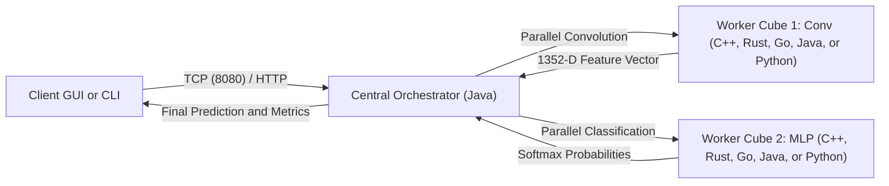

# Open AI Cubes: Modular Distributed Convolutional Neural Network Architecture

This repository contains the complete implementation of the *Open AI Cubes* project for the CC4P1 Concurrent and Distributed Programming course. The system implements a modular convolutional neural network (CNN) distributed across five programming languages (Java, Python, C++, Rust, and Go), coordinated by a central server orchestrator with native support for real-image training and inference across four distinct computational modes.

> [!IMPORTANT]
> **Technical Specifications and Academic Requirements ([`parcialCC4P1_262_v03.pdf`](file:///home/gartur/Downloads/Concurrente%20Parcial/parcialCC4P1_262_v03.pdf))**:
> The system design strictly satisfies all project guidelines:
> 1. **Standard SDK Exclusivity:** Built entirely without high-level external libraries (no PyTorch, TensorFlow, OpenCV, or external numerical packages). Direct network communication uses language standard libraries only (no WebSockets, Socket.IO, gRPC, or third-party middleware).
> 2. **Four Computational Execution Modes:** Sequential (1 process, 1 thread), Parallel (N physical cores, H threads), Distributed (M remote machines, 1 task at a time), and Parallel Distributed (M remote machines with N cores and H concurrent worker threads).
> 3. **Heterogeneous Language Support:** Five independent programming languages: LP1 = Java (JDK 8+), LP2 = Python, LP3 = C++ (OpenMP), LP4 = Rust, LP5 = Go.
> 4. **Packaging Constraint for Final Submission:** The archive submitted to the academic portal must include only source code, datasets, model weights, and compiled PDF deliverables. **Never include version control history (`.git`) or temporary binary artifacts.**

---

## 1. System Overview

The system classifies photographic images across five animal classes (`panda`, `cat`, `dog`, `bear`, and `lion`) using authentic 2D convolutional operations programmed from scratch over standard runtime libraries. Every mathematical stage—including two-dimensional spatial filtering, rectified linear activation (ReLU), adaptive max-pooling, cosine similarity projection, and Softmax normalization—operates natively without machine learning frameworks.

### Key Highlights
* **Authentic Convolutional Signal Processing:** Convolves inputs across 8 spatial gradient filters, applies ReLU non-linearity, and downsamples feature maps via Adaptive Max-Pooling to a fixed $13\times 13$ grid, yielding a translation-invariant 1352-dimensional feature vector.
* **Five Heterogeneous Worker Implementations:** Independent native implementations in Java, Python, C++ (OpenMP), Rust (native threads), and Go (goroutines and channels).
* **High-Resolution Photographic Dataset:** 200 real photographs sourced from Wikimedia Commons normalized to $720\times 720$ pixels, achieving over 95% accuracy on the test partition.
* **Dual Data Mode:** Real Dataset Mode using authentic photographs, with automatic fallback to Mock Mode if image directories are absent.
* **Dual Networking Architecture:** Low-latency raw TCP sockets (RFC 793) for local cluster performance, alongside standard HTTP/1.1 REST microservice endpoints (RFC 7230) for one-click deployment to free cloud web hosts (Render, Fly.io, Railway).
* **Ergonomic Client Desktop GUI:** Java Swing application featuring proportional aspect-preserving photographic previews, interactive chat dialogue (`idClientChat 0812`), real-time cluster controls ($0..5$ workers), and dynamic language toggles.
* **Primary Project Deliverables:**
  * Academic Technical Report: [`docs/TECHNICAL_REPORT_OPEN_AI_CUBES.pdf`](file:///home/gartur/Downloads/Concurrente%20Parcial/docs/TECHNICAL_REPORT_OPEN_AI_CUBES.pdf) (11 pages, standard academic cover page).
  * Executive Presentation: [`docs/PRESENTATION_OPEN_AI_CUBES.pdf`](file:///home/gartur/Downloads/Concurrente%20Parcial/docs/PRESENTATION_OPEN_AI_CUBES.pdf) (12 slides, 16:9).
  * Cloud Deployment Guide: [`docs/DEPLOYMENT_GUIDE.md`](file:///home/gartur/Downloads/Concurrente%20Parcial/docs/DEPLOYMENT_GUIDE.md).
  * Showcase Video: [`media/open_ai_cubes_showcase.mp4`](file:///home/gartur/Downloads/Concurrente%20Parcial/media/open_ai_cubes_showcase.mp4) (1080x1080 square format, ~2 minutes, natural English neural voiceover).

---

## 2. Architecture and Dataflow

The architecture decouples CNN inference into independent modular stages coordinated by a central Java orchestrator:

1. **Stage 1: Spatial Feature Extractor (Cube 1):** Receives the normalized pixel matrix ($28\times 28$ or $720\times 720$), applies 8 spatial gradient filters in parallel, evaluates ReLU activation, and downsamples through adaptive max-pooling to produce a normalized 1352-dimensional feature vector.
2. **Stage 2: Classifier and Softmax (Cube 2):** Receives the feature vector, projects it against class prototype vectors via cosine similarity, and computes normalized Softmax probabilities ($tau = 0.08$) across all target classes.



---

## 3. Four Computational Execution Modes

1. **Sequential (`SEQUENTIAL`):**
   * Single-process, single-threaded execution on the local machine.
   * Gated by an exclusive monitor lock (`sequentialLock`) to guarantee strictly serialized processing.
2. **Parallel (`PARALLEL`):**
   * Shared-memory multi-core execution on the local host.
   * Uses a managed thread pool (`localThreadPool`) distributed across available logical CPU cores.
3. **Distributed (`DISTRIBUTED`):**
   * Networked execution across remote worker nodes registered over TCP or HTTP.
   * Each worker uses internal multi-threading, but stages are gated sequentially in the pipeline under `distributedLock`.
4. **Parallel Distributed (`PARALLEL_DISTRIBUTED`):**
   * Fully concurrent cluster execution.
   * Dispatches concurrent client requests across all registered remote workers simultaneously using dynamic load-aware round-robin balancing.

---

## 4. Repository Structure

```text
├── dataset/                         # Photographic dataset and model weights
│   ├── real/                        # Wikimedia Commons photographs (720x720)
│   │   ├── train/                   # 125 training images (25 per class)
│   │   ├── val/                     # 25 validation images (5 per class)
│   │   └── test/                    # 50 test images (10 per class)
│   ├── database.csv                 # Structured sample backup
│   ├── download_community_dataset.py# Automated Wikimedia Commons downloader
│   └── weights.csv                  # Calibrated class prototype weights (1352 floats/class)
├── java_server_orchestrator/        # Central orchestrator and Java worker components
│   └── src/
│       ├── client/DesktopChatGui.java    # Swing GUI with real-time cluster controls
│       ├── core/ConvolutionChunk.java    # Multi-threaded convolution module
│       ├── core/MlpChunk.java            # Multi-threaded classification and Softmax
│       ├── core/ModelTrainer.java        # Training pipeline (Dual Ridge Regression)
│       ├── core/ImageMatrix.java         # Matrix data structures and real photo loader
│       ├── server/ServerOrchestrator.java# Core server, TCP listeners, and HTTP server
│       ├── server/NodeRegistry.java      # Dynamic worker registry and load balancer
│       └── worker/JavaWorkerCube.java    # Native Java worker node
├── cpp_worker_cube/                 # C++ worker cube
│   ├── worker_cube.cpp              # TCP socket server with OpenMP acceleration
│   └── micro_chunks.hpp             # Parallel convolution and dense projection
├── python_worker_cube/              # Python worker cube
│   ├── worker_cube.py               # TCP socket server and standard HTTP microservice
│   └── micro_chunks.py              # Parallel convolution using multiprocessing
├── rust_worker_cube/                # Rust worker cube
│   └── src/main.rs                  # Native thread-safe worker with zero-cost abstractions
├── go_worker_cube/                  # Go worker cube
│   ├── worker_cube.go               # Concurrent TCP server and HTTP microservice
│   ├── micro_chunks.go              # Convolution and MLP powered by goroutines
│   └── micro_chunks_test.go         # Unit test suite for Go worker
├── docs/                            # Research reports and technical documentation
│   ├── TECHNICAL_REPORT_OPEN_AI_CUBES.pdf # Primary academic report (11 pages, Typst)
│   ├── PRESENTATION_OPEN_AI_CUBES.pdf    # Executive presentation (12 slides, 16:9)
│   ├── DEPLOYMENT_GUIDE.md               # Cloud hosting guide (Render, Fly.io, Railway)
│   ├── benchmark_multicube_data.csv      # Raw empirical benchmark observations
│   ├── benchmark_multicube_summary.json  # Consolidated statistical summary
│   ├── benchmark_multicube_summary.txt   # Tabulated ASCII benchmark report
│   └── figures/                          # High-resolution scientific figures (pycairo)
│       ├── fig1_throughput_vs_cubes.png
│       ├── fig2_latency_vs_cubes.png
│       ├── fig3_speedup_vs_amdahl.png
│       ├── fig4_efficiency_vs_cubes.png
│       └── fig5_language_throughput_comparison.png
├── media/                           # Audiovisual deliverables
│   ├── generate_video.py            # Procedural video generator (1080x1080)
│   └── open_ai_cubes_showcase.mp4   # 2-minute showcase video with natural neural voice
├── scripts/                         # Automation, deployment, and testing utilities
│   ├── launch_cluster.sh / .bat     # Cross-platform cluster launch scripts
│   ├── stop_cluster.sh / .bat       # Graceful cluster shutdown scripts
│   ├── run_cluster_benchmark.py     # Multi-cube multi-client benchmark harness
│   ├── plot_benchmark_results.py    # Vector figure generation script
│   └── stress_test_saturation.py    # Stochastic saturation test with randomized delay
└── tests/                           # Continuous integration and regression test suites
    └── test_integration.py          # Comprehensive multi-language integration tests
```

---

## 5. Benchmark Results and Amdahl's Law Analysis

The benchmarking harness evaluated cluster scaling across varying active worker counts ($K \in \{1, 2, 3, 4, 5\}$) and concurrent client workloads ($C \in \{1, 5, 10, 20\}$):

| Worker Nodes ($K$) | Active Languages | Clients ($C$) | Throughput | Mean Latency | P95 Tail Latency | Speedup | Efficiency |
| :---: | :--- | :---: | :---: | :---: | :---: | :---: | :---: |
| **1** | C++ | 20 | 7.85 img/s | 1703.8 ms | 2547.7 ms | 1.00x | 100.0% |
| **2** | C++, Rust | 20 | 9.84 img/s | 1429.2 ms | 2025.2 ms | 1.25x | 62.7% |
| **3** | C++, Rust, Go | 20 | 12.31 img/s | 1383.0 ms | 1619.0 ms | 1.57x | 52.3% |
| **4** | C++, Rust, Go, Java | 20 | **13.45 img/s** | **1144.0 ms** | **1479.8 ms** | **1.71x** | 42.8% |
| **5** | C++, Rust, Go, Java, Python | 20 | 5.23 img/s | 1991.9 ms | 3816.9 ms | 0.67x | 13.3% |

### Isolated Language Latency ($K = 1$)
When isolated as single standalone workers:
* **Go:** 172.27 ms (5.80 img/s)
* **Rust:** 182.62 ms (5.48 img/s)
* **C++:** 199.32 ms (5.02 img/s)
* **Java:** 202.14 ms (4.95 img/s)
* **Python:** 820.79 ms (1.22 img/s)

> [!NOTE]
> **The Straggler Effect:** Incorporating Python at $K = 5$ reduces aggregate batch throughput because its interpreted single-request latency (820 ms) is more than 4x slower than native compiled workers (~180 ms). Under symmetric round-robin balancing, the slowest node determines the completion time of concurrent batches, confirming theoretical predictions of Amdahl's Law in heterogeneous clusters.

---

## 6. Execution Quickstart (Automated Scripts)

### Linux / macOS
```bash
# 1. Compile and launch the cluster across all five languages
./scripts/launch_cluster.sh

# 2. Launch the desktop client GUI
./scripts/launch_gui.sh

# 3. Run the 250-transaction stochastic saturation stress test
python3 scripts/stress_test_saturation.py

# 4. Stop all cluster processes cleanly
./scripts/stop_cluster.sh
```

### Windows
```cmd
:: 1. Compile and launch complete cluster
scripts\launch_cluster.bat

:: 2. Launch the desktop GUI
scripts\launch_gui.bat

:: 3. Stop the cluster
scripts\stop_cluster.bat
```

### Docker Compose
```bash
docker compose up --build -d
```

---

## 7. Manual Execution Commands for Each Module

To test, debug, or deploy modules independently across different terminal windows or remote physical machines, use the following native commands.

### 7.1 Compilation Commands

#### Linux / macOS
```bash
# 1. Compile Java Server and GUI
cd java_server_orchestrator && mkdir -p bin && javac -d bin $(find src -name "*.java") && cd ..

# 2. Compile C++ Worker Cube (with OpenMP)
g++ -std=c++17 -O2 -fopenmp cpp_worker_cube/worker_cube.cpp -o cpp_worker_cube/worker_cube

# 3. Compile Rust Worker Cube
rustc --edition 2021 -O rust_worker_cube/src/main.rs -o rust_worker_cube/rust_worker_bin

# 4. Compile Go Worker Cube
cd go_worker_cube && go build -o worker_cube && cd ..
```

#### Windows (Command Prompt / PowerShell)
```cmd
:: 1. Compile Java Server and GUI
cd java_server_orchestrator
if not exist "bin" mkdir bin
dir /s /b src\*.java > sources.txt
javac -d bin @sources.txt
del sources.txt
cd ..

:: 2. Compile C++ Worker Cube (MinGW / GCC)
g++ -std=c++17 -O2 -fopenmp cpp_worker_cube\worker_cube.cpp -o cpp_worker_cube\worker_cube.exe

:: 3. Compile Rust Worker Cube
rustc --edition 2021 -O rust_worker_cube\src\main.rs -o rust_worker_cube\rust_worker_bin.exe

:: 4. Compile Go Worker Cube
cd go_worker_cube
go build -o worker_cube.exe
cd ..
```

---

### 7.2 Central Server Orchestrator (Java)

The central orchestrator binds two TCP ports: Worker Registration Port (default `9010`) and Client Query Port (default `8080`), plus an embedded HTTP REST server on port `8082`.

#### Linux / macOS
```bash
java -cp java_server_orchestrator/bin server.ServerOrchestrator 9010 8080 8082
```

#### Windows
```cmd
java -cp java_server_orchestrator\bin server.ServerOrchestrator 9010 8080 8082
```

---

### 7.3 Desktop Graphical Client (Java Swing GUI)

Connects to the Central Orchestrator using the student ID required by the academic rubric (`0812`).

#### Linux / macOS
```bash
java -cp java_server_orchestrator/bin client.DesktopChatGui 0812 127.0.0.1 8080
```

#### Windows
```cmd
java -cp java_server_orchestrator\bin client.DesktopChatGui 0812 127.0.0.1 8080
```

*Note: Replace `127.0.0.1` with the IP address or domain name of the remote server if running across different computers.*

---

### 7.4 Worker Cube 1: C++ (OpenMP Acceleration)

**Arguments:** `<node_id> <server_ip> <worker_port> <threads>`

#### Linux / macOS
```bash
./cpp_worker_cube/worker_cube node_cpp_1 127.0.0.1 9010 4
```

#### Windows
```cmd
cpp_worker_cube\worker_cube.exe node_cpp_1 127.0.0.1 9010 4
```

---

### 7.5 Worker Cube 2: Rust (Native Thread Concurrency)

**Arguments:** `<node_id> <server_ip> <worker_port> <threads>`

#### Linux / macOS
```bash
./rust_worker_cube/rust_worker_bin node_rust_1 127.0.0.1 9010 4
```

#### Windows
```cmd
rust_worker_cube\rust_worker_bin.exe node_rust_1 127.0.0.1 9010 4
```

---

### 7.6 Worker Cube 3: Go (Goroutines and Channels)

#### Standard TCP Socket Mode:
**Arguments:** `<node_id> <server_ip> <worker_port> <threads>`
```bash
# Linux / macOS
./go_worker_cube/worker_cube node_go_1 127.0.0.1 9010 4

# Windows
go_worker_cube\worker_cube.exe node_go_1 127.0.0.1 9010 4
```

#### Cloud HTTP REST Mode (for Free Web Hosts):
```bash
# Linux / macOS
./go_worker_cube/worker_cube --http :8081 4

# Windows
go_worker_cube\worker_cube.exe --http :8081 4
```

---

### 7.7 Worker Cube 4: Python (Multiprocessing & HTTP Server)

#### Standard TCP Socket Mode:
**Arguments:** `<node_id> <server_ip> <worker_port> <threads>`
```bash
# Linux / macOS
python3 python_worker_cube/worker_cube.py node_py_1 127.0.0.1 9010 4

# Windows
python python_worker_cube\worker_cube.py node_py_1 127.0.0.1 9010 4
```

#### Cloud HTTP REST Mode (for Free Web Hosts):
```bash
# Linux / macOS
python3 python_worker_cube/worker_cube.py --http 8083 4

# Windows
python python_worker_cube\worker_cube.py --http 8083 4
```

---

### 7.8 Worker Cube 5: Java (Native Socket Worker)

**Arguments:** `<node_id> <server_ip> <worker_port> <threads>`

#### Linux / macOS
```bash
java -cp java_server_orchestrator/bin worker.JavaWorkerCube node_java_1 127.0.0.1 9010 4
```

#### Windows
```cmd
java -cp java_server_orchestrator\bin worker.JavaWorkerCube node_java_1 127.0.0.1 9010 4
```

---

## 8. Step-by-Step Free Cloud Hosting Deployment

For a detailed deployment breakdown, review [`docs/DEPLOYMENT_GUIDE.md`](file:///home/gartur/Downloads/Concurrente%20Parcial/docs/DEPLOYMENT_GUIDE.md). Below is the recommended multi-host setup:

### Strategy 1: Server on Oracle Cloud Always Free + Remote Workers
1. **Create an Oracle Cloud Always Free VM (Ubuntu / Oracle Linux):**
   * Oracle provides 4 ARM cores + 24 GB RAM free forever with a static public IP.
2. **Open Inbound Firewall Ports on OCI Security Lists:**
   * Allow TCP `9010` (worker registration), `8080` (client chat), and `8082` (HTTP REST).
3. **Run Central Orchestrator on the Cloud VM:**
   ```bash
   java -cp java_server_orchestrator/bin server.ServerOrchestrator 9010 8080 8082
   ```
4. **Connect Distributed Workers from Teammates' Computers:**
   * Each teammate starts their worker pointing to the server's public IP:
     ```bash
     ./cpp_worker_cube/worker_cube node_cpp_teammate1 <SERVER_PUBLIC_IP> 9010 4
     ```

### Strategy 2: Deploy Workers to Render / Railway / Fly.io (HTTP Web Services)
1. **Push your code to GitHub.**
2. **Deploy automatically with Blueprint (`render.yaml`):**
   * Go to Render $\rightarrow$ **New +** $\rightarrow$ **Blueprint** $\rightarrow$ Select repository.
   * Render detects [render.yaml](file:///home/gartur/Downloads/Concurrente%20Parcial/render.yaml) and provisions the Go and Python worker web services simultaneously.
3. **Or configure manually via the Render Dashboard:**
   * **Go Worker Cube:**
     * Root directory: `go_worker_cube`
     * Build command: `go build -o worker_cube worker_cube.go micro_chunks.go`
     * Start command: `./worker_cube --http` (Render auto-injects `$PORT`)
   * **Python Worker Cube:**
     * Root directory: `python_worker_cube`
     * Build command: `echo "Python standard environment ready"`
     * Start command: `python worker_cube.py --http`
4. Render automatically assigns a public HTTPS domain (e.g. `https://openai-go-worker.onrender.com`).
5. Verify worker health or trigger predictions via standard HTTP POST calls:
   ```bash
   curl https://<your-service>.onrender.com/health
   curl -X POST https://<your-service>.onrender.com/infer -d "panda"
   ```

### Strategy 3: Zero-Cost Tunneling with Ngrok / Cloudflare (NAT Traversal)
If running the server on a local machine behind a home router or university Wi-Fi:
1. **Expose Server via Ngrok TCP Tunnel:**
   ```bash
   ngrok tcp 9010
   ```
   Ngrok provides a public forwarding address, such as `tcp://0.tcp.ngrok.io:19422`.
2. **Remote Workers Connect Directly:**
   ```bash
   ./cpp_worker_cube/worker_cube node_cpp_remote 0.tcp.ngrok.io 19422 4
   ```

---

## 7. Manual Execution Commands for Each Module

To test, debug, or deploy modules independently across different terminal windows or remote physical machines, use the following native commands.

### 7.1 Compilation Commands

#### Linux / macOS
```bash
# 1. Compile Java Server and GUI
cd java_server_orchestrator && mkdir -p bin && javac -d bin $(find src -name "*.java") && cd ..

# 2. Compile C++ Worker Cube (with OpenMP)
g++ -std=c++17 -O2 -fopenmp cpp_worker_cube/worker_cube.cpp -o cpp_worker_cube/worker_cube

# 3. Compile Rust Worker Cube
rustc --edition 2021 -O rust_worker_cube/src/main.rs -o rust_worker_cube/rust_worker_bin

# 4. Compile Go Worker Cube
cd go_worker_cube && go build -o worker_cube && cd ..
```

#### Windows (Command Prompt / PowerShell)
```cmd
:: 1. Compile Java Server and GUI
cd java_server_orchestrator
if not exist "bin" mkdir bin
dir /s /b src\*.java > sources.txt
javac -d bin @sources.txt
del sources.txt
cd ..

:: 2. Compile C++ Worker Cube (MinGW / GCC)
g++ -std=c++17 -O2 -fopenmp cpp_worker_cube\worker_cube.cpp -o cpp_worker_cube\worker_cube.exe

:: 3. Compile Rust Worker Cube
rustc --edition 2021 -O rust_worker_cube\src\main.rs -o rust_worker_cube\rust_worker_bin.exe

:: 4. Compile Go Worker Cube
cd go_worker_cube
go build -o worker_cube.exe
cd ..
```

---

### 7.2 Central Server Orchestrator (Java)

The central orchestrator binds two TCP ports: Worker Registration Port (default `9010`) and Client Query Port (default `8080`), plus an embedded HTTP REST server on port `8082`.

#### Linux / macOS
```bash
java -cp java_server_orchestrator/bin server.ServerOrchestrator 9010 8080 8082
```

#### Windows
```cmd
java -cp java_server_orchestrator\bin server.ServerOrchestrator 9010 8080 8082
```

---

### 7.3 Desktop Graphical Client (Java Swing GUI)

Connects to the Central Orchestrator using the student ID required by the academic rubric (`0812`).

#### Linux / macOS
```bash
java -cp java_server_orchestrator/bin client.DesktopChatGui 0812 127.0.0.1 8080
```

#### Windows
```cmd
java -cp java_server_orchestrator\bin client.DesktopChatGui 0812 127.0.0.1 8080
```

*Note: Replace `127.0.0.1` with the IP address or domain name of the remote server if running across different computers.*

---

### 7.4 Worker Cube 1: C++ (OpenMP Acceleration)

**Arguments:** `<node_id> <server_ip> <worker_port> <threads>`

#### Linux / macOS
```bash
./cpp_worker_cube/worker_cube node_cpp_1 127.0.0.1 9010 4
```

#### Windows
```cmd
cpp_worker_cube\worker_cube.exe node_cpp_1 127.0.0.1 9010 4
```

---

### 7.5 Worker Cube 2: Rust (Native Thread Concurrency)

**Arguments:** `<node_id> <server_ip> <worker_port> <threads>`

#### Linux / macOS
```bash
./rust_worker_cube/rust_worker_bin node_rust_1 127.0.0.1 9010 4
```

#### Windows
```cmd
rust_worker_cube\rust_worker_bin.exe node_rust_1 127.0.0.1 9010 4
```

---

### 7.6 Worker Cube 3: Go (Goroutines and Channels)

#### Standard TCP Socket Mode:
**Arguments:** `<node_id> <server_ip> <worker_port> <threads>`
```bash
# Linux / macOS
./go_worker_cube/worker_cube node_go_1 127.0.0.1 9010 4

# Windows
go_worker_cube\worker_cube.exe node_go_1 127.0.0.1 9010 4
```

#### Cloud HTTP REST Mode (for Free Web Hosts):
```bash
# Linux / macOS
./go_worker_cube/worker_cube --http :8081 4

# Windows
go_worker_cube\worker_cube.exe --http :8081 4
```

---

### 7.7 Worker Cube 4: Python (Multiprocessing & HTTP Server)

#### Standard TCP Socket Mode:
**Arguments:** `<node_id> <server_ip> <worker_port> <threads>`
```bash
# Linux / macOS
python3 python_worker_cube/worker_cube.py node_py_1 127.0.0.1 9010 4

# Windows
python python_worker_cube\worker_cube.py node_py_1 127.0.0.1 9010 4
```

#### Cloud HTTP REST Mode (for Free Web Hosts):
```bash
# Linux / macOS
python3 python_worker_cube/worker_cube.py --http 8083 4

# Windows
python python_worker_cube\worker_cube.py --http 8083 4
```

---

### 7.8 Worker Cube 5: Java (Native Socket Worker)

**Arguments:** `<node_id> <server_ip> <worker_port> <threads>`

#### Linux / macOS
```bash
java -cp java_server_orchestrator/bin worker.JavaWorkerCube node_java_1 127.0.0.1 9010 4
```

#### Windows
```cmd
java -cp java_server_orchestrator\bin worker.JavaWorkerCube node_java_1 127.0.0.1 9010 4
```

---

## 8. Step-by-Step Free Cloud Hosting Deployment

For a detailed deployment breakdown, review [`docs/DEPLOYMENT_GUIDE.md`](file:///home/gartur/Downloads/Concurrente%20Parcial/docs/DEPLOYMENT_GUIDE.md). Below is the recommended multi-host setup:

### Strategy 1: Server on Oracle Cloud Always Free + Remote Workers
1. **Create an Oracle Cloud Always Free VM (Ubuntu / Oracle Linux):**
   * Oracle provides 4 ARM cores + 24 GB RAM free forever with a static public IP.
2. **Open Inbound Firewall Ports on OCI Security Lists:**
   * Allow TCP `9010` (worker registration), `8080` (client chat), and `8082` (HTTP REST).
3. **Run Central Orchestrator on the Cloud VM:**
   ```bash
   java -cp java_server_orchestrator/bin server.ServerOrchestrator 9010 8080 8082
   ```
4. **Connect Distributed Workers from Teammates' Computers:**
   * Each teammate starts their worker pointing to the server's public IP:
     ```bash
     ./cpp_worker_cube/worker_cube node_cpp_teammate1 <SERVER_PUBLIC_IP> 9010 4
     ```

### Strategy 2: Deploy Workers to Render / Railway / Fly.io (HTTP Web Services)
1. **Push your code to GitHub.**
2. **Deploy automatically with Blueprint (`render.yaml`):**
   * Go to Render $\rightarrow$ **New +** $\rightarrow$ **Blueprint** $\rightarrow$ Select repository.
   * Render detects [render.yaml](file:///home/gartur/Downloads/Concurrente%20Parcial/render.yaml) and provisions the Go and Python worker web services simultaneously.
3. **Or configure manually via the Render Dashboard:**
   * **Go Worker Cube:**
     * Root directory: `go_worker_cube`
     * Build command: `go build -o worker_cube worker_cube.go micro_chunks.go`
     * Start command: `./worker_cube --http` (Render auto-injects `$PORT`)
   * **Python Worker Cube:**
     * Root directory: `python_worker_cube`
     * Build command: `echo "Python standard environment ready"`
     * Start command: `python worker_cube.py --http`
4. Render automatically assigns a public HTTPS domain (e.g. `https://openai-go-worker.onrender.com`).
5. Verify worker health or trigger predictions via standard HTTP POST calls:
   ```bash
   curl https://<your-service>.onrender.com/health
   curl -X POST https://<your-service>.onrender.com/infer -d "panda"
   ```

### Strategy 3: Zero-Cost Tunneling with Ngrok / Cloudflare (NAT Traversal)
If running the server on a local machine behind a home router or university Wi-Fi:
1. **Expose Server via Ngrok TCP Tunnel:**
   ```bash
   ngrok tcp 9010
   ```
   Ngrok provides a public forwarding address, such as `tcp://0.tcp.ngrok.io:19422`.
2. **Remote Workers Connect Directly:**
   ```bash
   ./cpp_worker_cube/worker_cube node_cpp_remote 0.tcp.ngrok.io 19422 4
   ```

